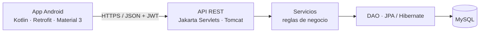

# 🐾 VetCare Solutions · Gestor de veterinaria


Sistema completo para la gestión de una veterinaria: **aplicación Android nativa**, **API REST segura** y **base de datos relacional**. Centraliza propietarios, mascotas, citas, historias clínicas y vacunas, con acceso por roles (administrador y veterinario).

Proyecto final de *Desarrollo de Aplicaciones Móviles Nativas* · Ingeniería de Software · Fundación Universitaria Compensar.

## ✨ Funcionalidades

| Módulo | Qué permite |
|---|---|
| **Acceso** | Inicio de sesión con JWT, registro eligiendo rol (veterinario o administrador), cierre de sesión y modo oscuro |
| **Aprobación de cuentas** | Toda cuenta nueva queda pendiente; el administrador la aprueba en un solo paso y activa también el perfil de veterinario |
| **Mascotas** | Consultar con filtros automáticos (nombre, especie, estado), crear, editar, desactivar y reactivar |
| **Propietarios** | Consultar por nombre, documento y estado; crear, editar, desactivar, reactivar y eliminar (solo si nunca tuvo mascotas) |
| **Citas** | Agendar, reprogramar, cancelar y atender, con control de cruces de horario |
| **Historia clínica** | Registrar la atención de una cita, con tratamientos y medicamentos |
| **Vacunas** | Carnet de vacunación y refuerzos próximos |
| **Administración** | Gestión de usuarios y veterinarios (solo administrador) |

## 🏗️ Arquitectura



La app **nunca** habla con la base de datos: toda petición pasa por un filtro de seguridad que valida el token y los permisos antes de llegar al controlador.

### Aplicación Android
- Kotlin, vistas XML con ViewBinding, Material 3 y corrutinas.
- Retrofit para la API, patrón repositorio y manejo uniforme de errores (401, 403, 409, sin conexión).
- Token y perfil guardados **cifrados** en el dispositivo.
- 17 pantallas; `minSdk 24`.

### Backend
- Java 17 · Jakarta Servlets · JPA/Hibernate · Maven (WAR en Tomcat).
- Seguridad: **JWT HS256**, contraseñas con **BCrypt**, bloqueo tras 5 intentos fallidos, revocación de token al cerrar sesión y permisos **denegados por defecto**.
- Errores en un formato único: `{ status, codigo, error, ruta }`.
- Auditoría de acciones, exportación a Excel y PDF, y documentación con **Swagger/OpenAPI**.

### Base de datos
- 15 tablas relacionadas con llaves foráneas e integridad referencial.
- `database/schema.sql` crea la estructura y `database/seed.sql` carga datos de ejemplo.

## 🔐 Roles

| | Administrador | Veterinario |
|---|:---:|:---:|
| Propietarios, mascotas, citas, historias, vacunas | ✅ | ✅ |
| Cambiar el estado (activar/desactivar) de propietarios y mascotas | ✅ | ❌ 403 |
| Eliminar registros | ✅ | ❌ 403 |
| Usuarios y veterinarios | ✅ | ❌ 403 |
| Aprobar cuentas nuevas | ✅ | ❌ 403 |

## 🚀 Puesta en marcha

### 1. Base de datos
```bash
mysql -u root -p < database/schema.sql
mysql -u root -p veterinaria < database/seed.sql
```

### 2. Backend
```bash
cd backend/veterinaria
mvn clean package
# desplegar target/veterinaria.war en Tomcat y abrir:
# http://localhost:8080/veterinaria/swagger/
```
Variables opcionales: `JWT_SECRET` (mínimo 32 caracteres), `DB_URL`, `DB_USER`, `DB_PASSWORD`.

### 3. App Android
1. Abrir la carpeta raíz del proyecto en **Android Studio**.
2. Conectar el celular por USB y crear el puente hacia el servidor:
   ```bash
   adb reverse tcp:8080 tcp:8080
   ```
3. Ejecutar la app. La dirección del servidor es `http://localhost:8080/veterinaria/api/` y se puede cambiar desde «Configurar servidor» en el login.

### Cuentas de demostración
| Usuario | Contraseña | Rol |
|---|---|---|
| `admin` | `admin123` | Administrador |
| `veterinario` | `vet12345` | Veterinario |

> Son credenciales de demostración únicamente.

## 🧪 Pruebas
- **162 pruebas de integración** contra Tomcat + MySQL reales: autenticación, roles (403), validaciones, reglas de negocio, registro y aprobación, estados, cierre de sesión y fuerza bruta.
  ```bash
  bash docs/pruebas/pruebas_api.sh http://localhost:8080/veterinaria
  ```
- Pruebas unitarias de los servicios: `mvn test`.
- Pruebas funcionales en un celular real, documentadas en [las evidencias](docs/EVIDENCIAS_VETCARE%20SOLUTIONS%20S.A.S.pdf).

## 📚 Documentación

| Documento | |
|---|---|
| [Documento empresarial y requisitos](docs/DOCUMENTO%20EMPRESARIAL_VETCARE%20SOLUTIONS%20S.A.S.pdf) | Requisitos funcionales y no funcionales, reglas de negocio |
| [Manual de instalación y de usuario](docs/MANUAL_VETCARE%20SOLUTIONS%20S.A.S.pdf) | Instalación y uso de cada pantalla |
| [Diagramas](docs/DIAGRAMAS_VETCARE%20SOLUTIONS%20S.A.S.pdf) | Arquitectura, casos de uso, actividades, secuencia, entidad-relación, componentes, navegación y clases |
| [Wireframes](docs/WIREFRAMES_VETCARE%20SOLUTIONS%20S.A.S.pdf) | Bocetos de las pantallas |
| [Evidencias](docs/EVIDENCIAS_VETCARE%20SOLUTIONS%20S.A.S.pdf) | Funcionamiento en un celular real |

La documentación de la API (Swagger) está en [`backend/veterinaria/src/main/webapp/swagger/openapi.json`](backend/veterinaria/src/main/webapp/swagger/openapi.json) y se ve en `/veterinaria/swagger/` con el servicio encendido.

## 📁 Estructura

```
ProyectoFinal/
├── app/                  App Android (Kotlin)
├── backend/veterinaria/  API REST (Java, Maven, WAR)
├── database/             schema.sql y seed.sql
└── docs/                 Documentación en PDF y script de pruebas
```

## 👩‍💻 Autores
- **Daniela Díaz Falla** · [@DanielaDiaz1510](https://github.com/DanielaDiaz1510)
- **William Fernando Guerrero**

Fundación Universitaria Compensar · Ingeniería de Software · 2026